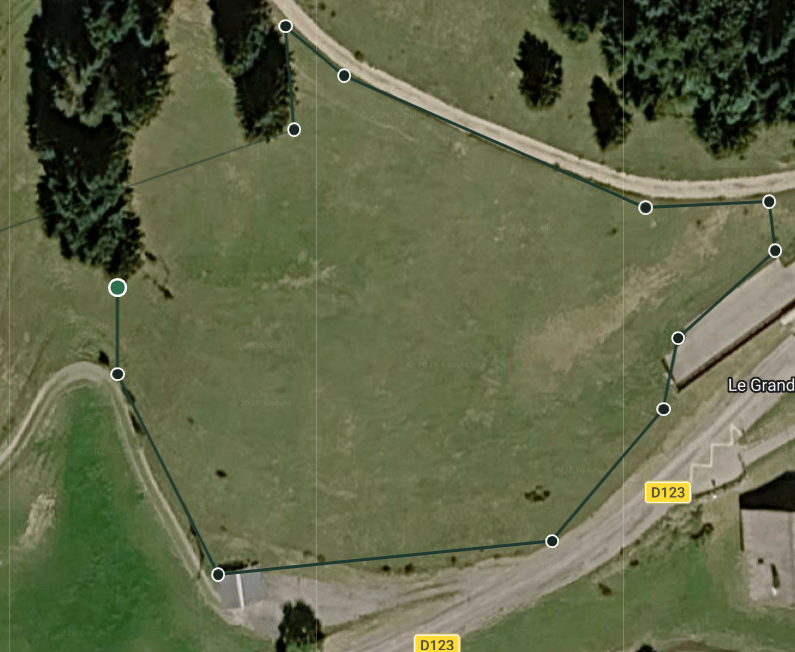

# Plantify

**Plantify is a free, in-browser planting planner for irregular land.** Trace a field on Google Maps, turn the outline into a measured plot, then lay out orchard, vineyard, or garden rows and count every plant — including a separate row along the fences.

No account. No server. The map is only used to capture the shape. The planting sheet is the result: area in square meters, side lengths, row direction, plant counts, and a fence line you can space independently.

Use Plantify to measure a plot of land, calculate tree spacing, plan a vineyard or orchard layout, and count plants on an irregular polygon without CAD software.

## How it works

The walkthrough below is a real 6,410 m² parcel. Perimeter is 337.1 m. The same steps apply to any closed outline you draw.

### 1. Trace the plot on satellite imagery

Navigate to the land, click each corner, and close the shape. Drag a corner to adjust it. Right-click a corner to remove it. Plantify records only the outline and its measurements — not the map itself.



### 2. Open the measured planting sheet

The outline leaves the map and becomes a clean sheet: area, perimeter, a length on every side, and a north mark. Drag to orbit the plot, scroll or pinch to zoom, and right-drag to pan. Nothing is planted until you enter distances.


### 3. Lay out rows and count plants

Enter the distance between planting lines on X and Y, a gap from the fence, and the fence row’s own offset and spacing. Rotate the direction dial so the grid faces the way you want. When the angle is within 5° of a side, Plantify snaps parallel to that edge.

In this example: **3 m × 7 m** field spacing, **2.6 m** gap, **1 m** in from the fence, **3 m** between fence plants, direction **0° parallel**.

Result: **266 plants** in the field grid, **106 plants along the fences**, counted separately.


### 4. Keep a gap — or plant up to a side

The dashed inner line is the field bed. Field plants stay inside it. Fence plants sit in the gap, parallel to each side, at the offset you set. Click a side to open it: that edge is planted up to the fence, and the fence row skips it.


## What Plantify calculates

| Measurement | What you get |
| --- | --- |
| **Plot area** | Square meters, plus hectares from 1 ha |
| **Perimeter** | Total fence length |
| **Side lengths** | A labeled length on every edge |
| **Field plants** | Grid crossings strictly inside the bed. The fence line itself is not counted |
| **Fence plants** | A separate row inside each side that still has a gap |
| **Direction** | 0–180°, with snap-to-parallel when you align with an edge |

Field plants and fence plants are two layers. They never share a count.

## Run it locally

Plantify is a Vite single-page app. Node.js is required.

```bash
npm install
npm run dev
```

Open [http://localhost:5173](http://localhost:5173). A sample irregular plot near Lyon loads already measured, so you can try spacing and counts without drawing first.

```bash
npm run build
npm run preview
```

## Trace your own land

To draw a real parcel you need a [Google Maps JavaScript API](https://developers.google.com/maps/documentation/javascript) key with billing enabled.

1. Enable the Maps JavaScript API in Google Cloud.
2. Copy `.env.example` to `.env`.
3. Set `VITE_GOOGLE_MAPS_API_KEY` to your key.
4. Restart the dev server.

Without a key, the measured sample sheet still works. Tracing a different plot does not.

On the map: **My location** pans to you if the browser allows it. **Undo**, **Close shape**, **Clear**, and **Show drawing** follow the outline. After you edit a closed shape, **Update drawing** rebuilds the sheet.

## Planting controls

| Control | Meaning |
| --- | --- |
| **Lines X / Y** | Meters between planting lines. Plants are the intersections inside the bed |
| **Gap** | Meters between the field layer and the fence. Click a side on the sheet to plant that side up to the fence |
| **Fences — m from the fence** | How far inside the boundary the fence row sits |
| **Fences — m apart** | Spacing along each fence |
| **Direction** | Drag, scroll, or use arrow keys. Shift for 0.1° steps. A north mark stays on the dial |

A gap that cannot be inset cleanly clears the field layer. Very dense plans (more than 400 lines on one axis) are refused so the sheet stays usable.

Nothing is saved. A refresh returns the sample plot and clears spacing, angle, and open sides.

## Project layout

| File | Role |
| --- | --- |
| `src/main.js` | Screens, planting form, live counts |
| `src/map.js` | Google Maps, corner drawing, polygon edit |
| `src/measure.js` | Local meters for the sample; spherical distances once a shape is closed on the map |
| `src/canvas.js` | Sheet, camera, inset bed, both planting layers, both counts |
| `src/dial.js` | Direction control |
| `src/sample-plot.js` | The six-corner outline loaded on a fresh start |

## Who it is for

Growers, orchard planners, vineyard designers, market gardeners, and anyone who needs a **tree planting calculator** or **row-spacing layout** on land that is not a rectangle. Typical uses:

- Measure an **irregular plot** from satellite imagery and get area plus fence lengths
- Plan an **orchard layout** or **vineyard row spacing** before ordering plants
- Count **field plants** and a **fence planting** row as two separate numbers
- Sketch a **garden design** on a real parcel without CAD

GitHub topics that match this project: `planting-planner`, `orchard-layout`, `vineyard-spacing`, `land-measurement`, `google-maps`, `plant-count`, `agriculture`, `gis`.

## License

Private prototype (`plantify` 0.1.0). Not published as a package.
